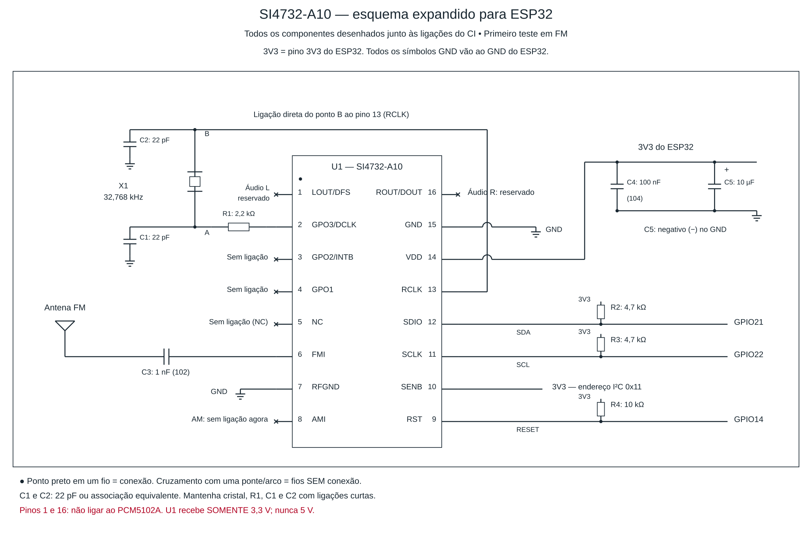

# RadioCiclista

**Um rádio de oficina feito para quem vive de bicicleta.**

RadioCiclista nasceu como um presente para o pai do autor, que trabalha com bicicletas. O projeto reúne um ESP32, tela ST7789, encoder e áudio estéreo com DAC PCM5102A. A identidade planejada inclui sons de bicicleta ao ligar e ao desligar.

**Estado atual: Bluetooth com áudio de boa qualidade confirmado pelo autor em 23/10/2026.** O receptor SI4732-A10 está em fase de montagem. AM/FM/SW, internet e sons de bicicleta ainda não estão implementados no firmware publicado.

## O que já existe

| Recurso | Estado em 23/10/2026 |
|---|---|
| Celular → Bluetooth A2DP → PCM5102A → HW-644 | Funcionamento com boa qualidade relatado pelo autor |
| Tela ST7789 e encoder EC11 | Integrados; orientação corrigida e funcionamento geral confirmado |
| Menu, volume, reprodução/pausa e botão K0 | Presentes no código; sem ensaio individual documentado de cada controle |
| SI4732-A10 e antena FM | Esquema de protótipo; montagem em andamento; recepção não validada |
| Recepção AM/SW | Planejada |
| Rádio pela internet | Planejada |
| Som de bicicleta ao ligar/desligar | Planejado |

## Começar pelo Bluetooth

Abra **[firmware/bluetooth/RadioCiclista/RadioCiclista.ino](firmware/bluetooth/RadioCiclista/RadioCiclista.ino)** na Arduino IDE. A pasta e o arquivo têm o mesmo nome, como a IDE exige.

O nome do projeto é RadioCiclista. O firmware validado mantém **RADIO_PCM5102** como nome Bluetooth e **RADIO ESP32** no cabeçalho da tela. Esses textos serão personalizados em uma revisão futura; o comportamento da versão validada foi preservado.

1. Use ESP32 clássico com Bluetooth Classic, como ESP32-WROOM-32. ESP32-S2, S3 e C3 não executam este receptor A2DP.
2. Instale as bibliotecas e selecione a placa conforme [guia do firmware](docs/firmware.md).
3. Monte conforme [ligações do Bluetooth e PCM5102A](hardware/ligacoes-bluetooth.md).
4. Grave, pareie o celular com **RADIO_PCM5102** e selecione Bluetooth no menu.

## Organização

```text
firmware/
  bluetooth/RadioCiclista/    programa principal validado pelo autor
  diagnosticos/              teste antigo do DAC interno, não usar com PCM5102A
hardware/
  ligacoes-bluetooth.md       montagem atual
  si4732-em-desenvolvimento.md
  componentes.md             lista por etapa
  esquemas/                  SVG editável e PNG do protótipo FM
docs/                        firmware, validação e próximos passos
assets/sons/                 requisitos dos sons futuros
tools/                       fontes dos esquemas desenhados por código
```

## Próxima etapa: receptor por antena

O SI4732-A10 será controlado por I²C. Consulte [o plano de montagem](hardware/si4732-em-desenvolvimento.md) antes de soldar. O caminho de áudio do receptor ainda será definido; suas saídas não devem ser unidas às saídas do PCM5102A.



O desenho é um esquema de montagem para o primeiro teste em FM, não uma placa de circuito impresso validada. Não inclui o circuito futuro de seleção de fontes de áudio.

## Origem e referências

Projeto de LucasSantosv, com apoio de ferramentas de IA na programação, documentação e desenho dos esquemas. Componentes, bibliotecas e circuitos de referência são creditados em [THIRD_PARTY.md](THIRD_PARTY.md). Não é alegada exclusividade do nome ou da arquitetura.

## Contribuir e reutilizar

Sugestões e melhorias são bem-vindas. Preserve a versão Bluetooth de referência e documente separadamente compilação, gravação e teste físico. Veja [CONTRIBUTING.md](CONTRIBUTING.md).

Código e documentação próprios publicados sob **GNU GPL v3.0**, conforme [LICENSE](LICENSE). Dependências mantêm suas próprias licenças. Documentos de terceiros são referenciados por links e não foram republicados como material próprio.
